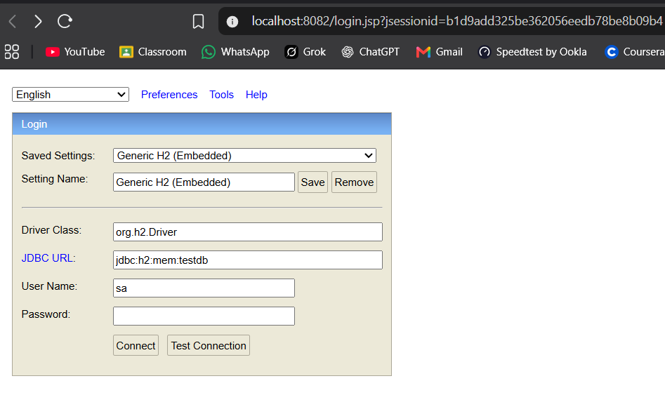
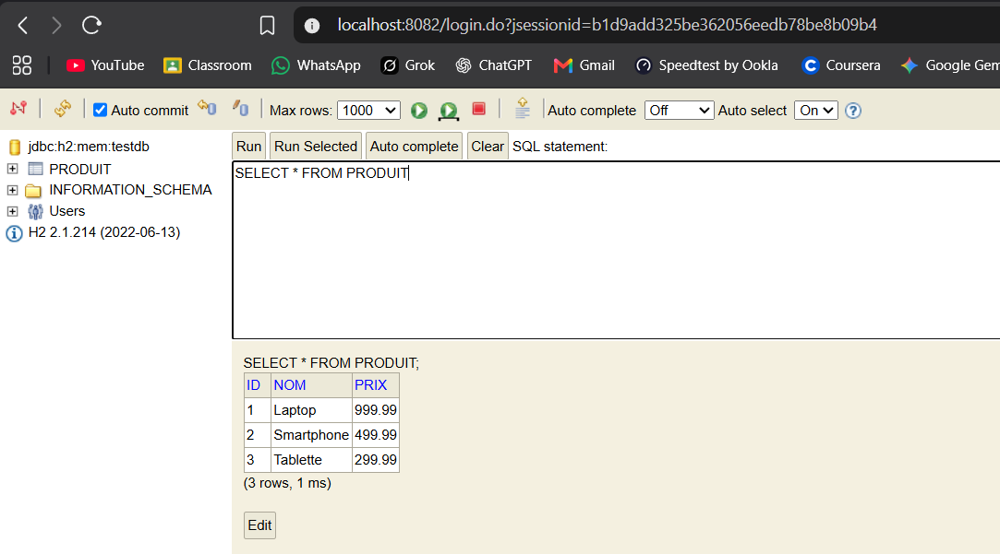
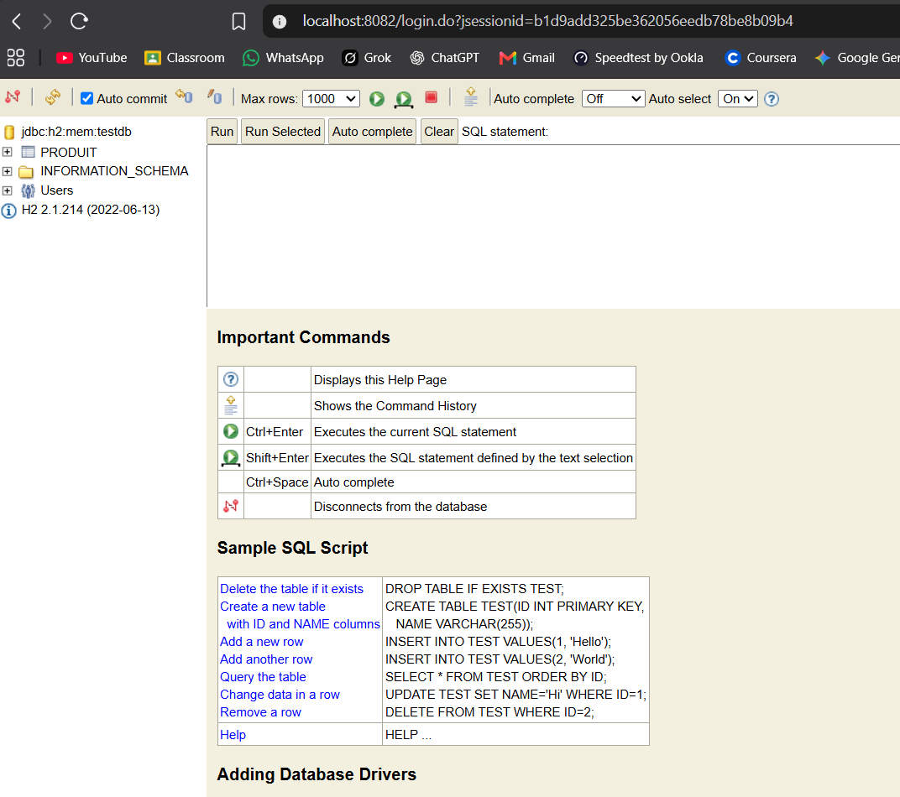

# Compte rendu — JEE Lab 1

Ce projet illustre une petite application Java JPA/Hibernate qui enregistre des `Produit` dans une base H2 en mémoire et affiche le résultat dans la console web H2.

## Objectif du TP

L'objectif était de mettre en place une persistance simple avec JPA/Hibernate, puis de vérifier que les données sont bien créées et visibles dans H2.

## Réalisation

- Connexion à `jdbc:h2:mem:testdb`
- Création de la table `PRODUIT`
- Insertion de trois produits de démonstration :
  - Laptop — `999.99`
  - Smartphone — `499.99`
  - Tablette — `299.99`
- Ouverture de la console H2 sur `http://localhost:8082`

## Résultat obtenu

Écran de connexion à H2 :



Résultat de la requête sur la table `PRODUIT` :



Page d'aide de H2 :



## Exécution

```bash
mvn exec:java
```

Le projet peut aussi être lancé depuis l'IDE en exécutant la classe principale.
